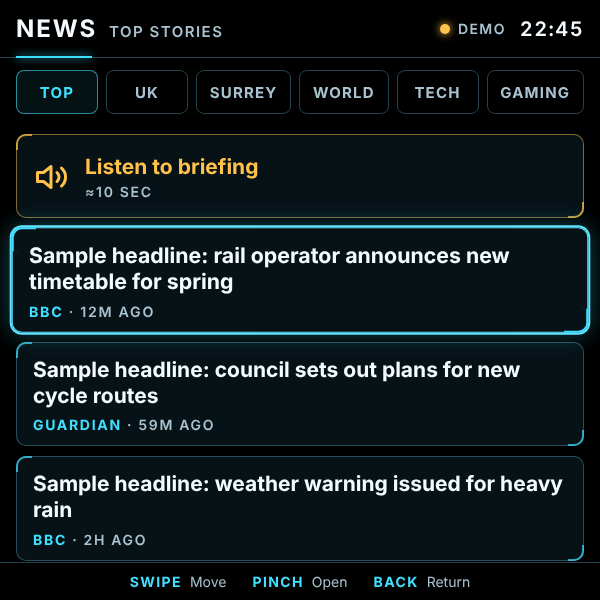
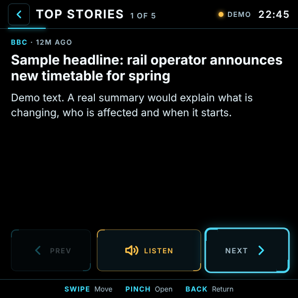

[README.md](https://github.com/user-attachments/files/33939434/README.md)
# News Deck

Glanceable news for **Meta Ray-Ban Display** glasses. Headlines from RSS feeds (BBC, Guardian, Surrey Live, gaming and tech sites…), short **AI summaries**, and a **spoken briefing** through the glasses speaker. Built for the Display's 600×600 screen and the Neural Band.

- **Sections as tabs:** Top, UK, Surrey, World, Tech and Gaming out of the box, and easy to change
- **AI summaries:** one or two sentences per story, plus a 30-second audio round-up
- **Works without AI too:** if no API key is set, it uses each outlet's own one-line description
- **Offline-friendly:** shows the last news it loaded if you lose signal
- **No password needed:** the page only shows public headlines, and the AI key stays on the server

| Headlines | Story |
|---|---|
|  |  |

---

## Setup

### 1. Copy the code
Fork this repository, or create your own with these files:

```
index.html
style.css
app.js
icon-96.png
api/news.js
```

### 2. Import it into Vercel
Choose **Add New → Project** and import the repo.
- **Framework preset:** Other
- **Build command:** leave empty
- **Output directory:** leave as default

> Can't see the repo in Vercel? Click **Adjust GitHub App Permissions** on the import screen and give Vercel access to it.

### 3. Turn on AI summaries (optional, recommended)
1. At [console.anthropic.com](https://console.anthropic.com), create an account, add a little credit under **Billing**, and set a monthly spending limit under **Limits**.
2. Under **API Keys**, create a normal **API key**. Don't use an Admin key.
3. In Vercel, go to **Settings → Environment Variables** and add:

| Name | Value |
|---|---|
| `ANTHROPIC_API_KEY` | Your Anthropic API key |
| `NEWS_MODEL` | *Optional.* The Claude model to use. Defaults to `claude-haiku-5-5`, the smallest and cheapest |

4. **Redeploy** (Deployments → ⋯ → Redeploy). Vercel only picks up variable changes on a new deployment.

### Optional: require an app key
If your Vercel address is public, you can stop other people using your AI credits by adding an `APP_KEY` variable: a random string of **letters and numbers only**. Redeploy, then open the app once with `https://YOUR-PROJECT.vercel.app/?key=YOUR_APP_KEY` (use that full link when adding it to your glasses). Without `APP_KEY`, the app needs no key.

Either way, requests with extra parameters are refused, so nobody can bypass the cache to trigger repeated AI calls.

### 4. Check it
Open `https://YOUR-PROJECT.vercel.app/api/news?section=top`. You'll see raw data. Look for:
- `"ai":true`: summaries are working.
- `"failed":[]`: every feed loaded. A name in the brackets means that feed couldn't be reached.

### 5. Add it to your glasses
In the Meta AI app, add a web app with the address `https://YOUR-PROJECT.vercel.app`.

## Using it

| Gesture | Where | Action |
|---|---|---|
| Swipe up / down | Headlines | Move through stories |
| Swipe left / right | Headlines | Previous / next section |
| Pinch | Headline | Open the story |
| Pinch | Listen to briefing | Hear a spoken round-up of the section |
| Pinch | Next / Prev | Page through stories without going back |
| Pinch | Listen | Hear the current story |
| Back | Anywhere | Return to the headlines |

Add `?demo` to the address to see sample stories without any setup.

---

## Adding your own topics and feeds

Everything lives in the **`SECTIONS` list at the top of `api/news.js`**. That's the only file you need to edit: the tabs on the glasses update themselves from it.

Each section looks like this:

```js
gaming: {
  tab: 'Gaming',     // text on the tab (keep it short, about 8 characters)
  label: 'Gaming',   // title at the top of the screen, also used in the briefing
  feeds: [
    ['Guardian Games', 'https://www.theguardian.com/games/rss'],
    ['Eurogamer', 'https://www.eurogamer.net/feed'],
  ],
},
```

- **The key** (`gaming` above) is a short id: lowercase letters, no spaces.
- **Each feed** is `['Name shown on the card', 'RSS feed address']`. Add as many as you like; the app takes the newest stories from each in turn, so one site can't crowd out the others, and removes duplicates.
- **Order:** tabs appear in the order sections are listed. Move a block up or down to reorder.
- **Removing** a section: delete its block. The tab disappears from the glasses automatically.

### Example: add a Football section
Add this inside `SECTIONS`, after the last section:

```js
football: {
  tab: 'Football',
  label: 'Football',
  feeds: [
    ['BBC Sport', 'https://feeds.bbci.co.uk/sport/football/rss.xml'],
    ['Guardian', 'https://www.theguardian.com/football/rss'],
  ],
},
```

Commit the change. Vercel redeploys, and the new tab appears next time the app loads news.

### Finding RSS feeds
- **BBC:** most sections have a feed at `https://feeds.bbci.co.uk/news/<section>/rss.xml`, e.g. `technology`, `science_and_environment`, `business`, `england/surrey`. Sport is at `https://feeds.bbci.co.uk/sport/<sport>/rss.xml`.
- **Guardian:** add `/rss` to almost any section page, e.g. `https://www.theguardian.com/games/rss`.
- **Other sites:** look for an RSS icon or a "Feeds" link, or try adding `/feed`, `/feed/` or `/rss` to the site's address. Sites built on WordPress almost always have `/feed/`.
- **To test a feed:** open its address in a browser. A page of text starting with `<rss` or `<?xml` (or a "subscribe to this feed" page) means it works.

### Ideas
| Topic | Feeds to try |
|---|---|
| Gaming | Guardian Games, Eurogamer, VGC, Rock Paper Shotgun, Nintendo Life, Push Square |
| Tech | BBC Technology, Guardian Technology, The Verge, Ars Technica |
| Science | BBC Science & Environment, Guardian Science, New Scientist |
| Local | BBC's regional feeds (`england/<county>`), your local paper's RSS |

### Limits
- **Stories per section:** 8 (set by `MAX_STORIES` in `api/news.js`).
- **Tabs:** six fit on screen. With more, the tab row scrolls sideways as you move along it.
- **Slow feeds** are skipped after 6 seconds, so one slow site never holds up the rest.

---

## How it works

- `api/news.js` runs on Vercel. It fetches the feeds, merges them, asks Claude for summaries and the briefing, and returns everything to the app.
- **Caching:** results are cached for **15 minutes** at Vercel's edge, so the feeds and the AI are used at most four times an hour per section, however many times the app opens. The AI cost is a few pence a day at most, and your spending limit caps it.
- **Accuracy:** summaries are written only from each outlet's own headline and standfirst. The AI is told not to add facts, but summaries can still be imperfect, so check the original before relying on a story.
- **Copyright:** the app shows short summaries and credits each source. It never copies full articles.

## Troubleshooting

| Symptom | Likely cause |
|---|---|
| `"ai":false` | `ANTHROPIC_API_KEY` missing or misnamed, or no redeploy since adding it. Check Vercel **Logs** for a "Summary failed…" line, which shows what went wrong |
| A name in `"failed"` | That feed is down or its address has changed. Open the address in a browser to check |
| "Couldn't load the news feeds" | Every feed in that section failed. Check the addresses |
| New section doesn't appear | Make sure the change is committed and deployed, then reopen the app. The tab list refreshes when news loads |
| "Open with ?key=… to connect" / "App key is wrong" | `APP_KEY` is set in Vercel. Open the app once with the full `?key=` link, using letters and numbers only |
| Checking `/api/news` in a browser says "App key missing" | Expected when `APP_KEY` is set: the browser doesn't send the key. Use Vercel's **Logs** instead, or remove `APP_KEY` temporarily |
| Briefing is silent | Check the glasses' volume. Speech uses the Display's built-in text-to-speech |

## Disclaimer

An independent hobby project. Not affiliated with or endorsed by Meta, Anthropic, Vercel, the BBC, the Guardian or any other news source. News content belongs to its publishers.
